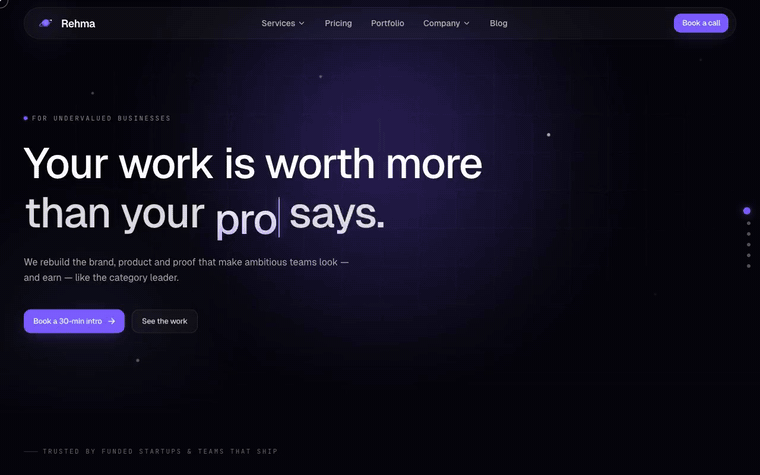
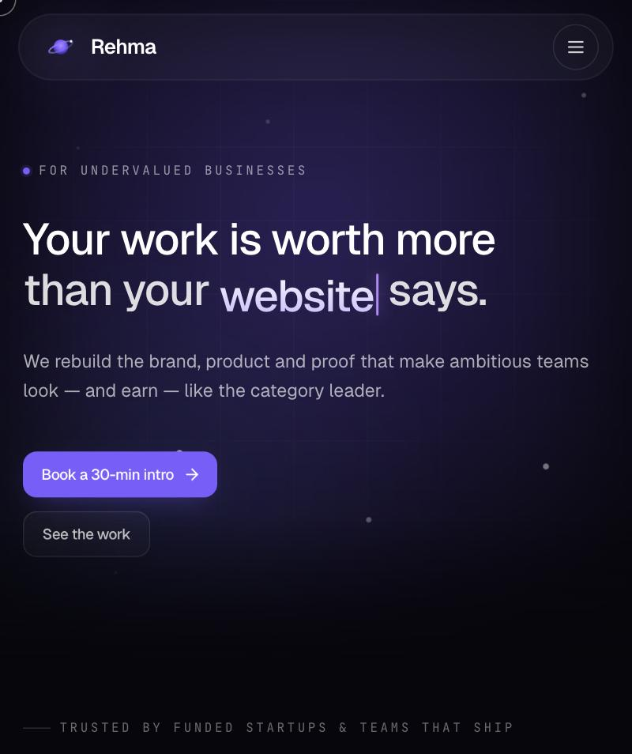
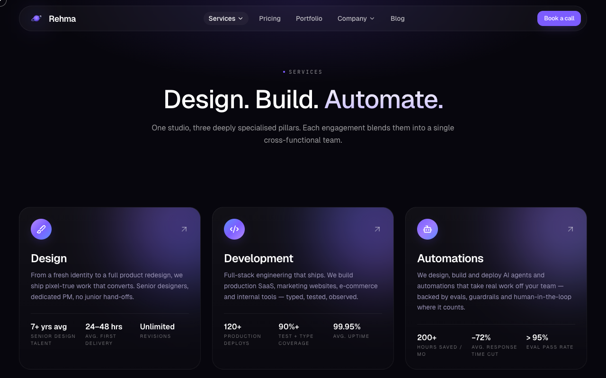
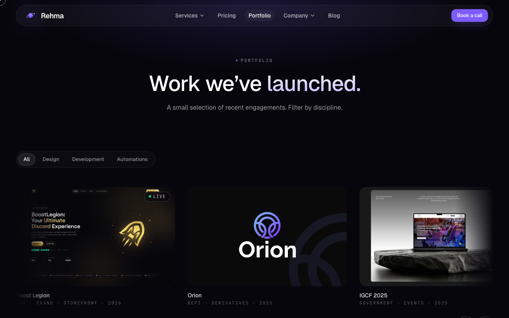

# Rehma Studio - Software Agency Marketing Website

A marketing website I built for Rehma, a small studio offering design, development and automation work for ambitious businesses. Live at [rehma.site](https://rehma.site).

<a href="media/demo.mp4">Watch the full-quality video</a>

## What it does

- A multi-page, mobile-first site with a 3D, space-themed hero and interactive scenes
- A services section with a detail page for each service offered
- A portfolio of case studies, filterable by type
- A blog and a pricing page with subscription tiers
- A contact page with an embedded booking calendar for intro calls

## Screenshots

**Home page**

**Services**

**Portfolio**

## Tech used

React, TypeScript and Vite, with Framer Motion and GSAP for animation, and React Three Fiber for the 3D hero scene.

---

This repository is a public overview only — the source code is kept private.
